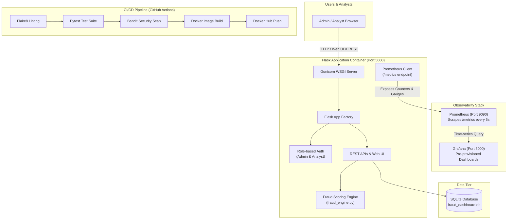

# 🛡️ FraudGuard - Fraud Detection Management Dashboard

A full-stack, DevOps-enabled financial transaction monitoring and fraud risk scoring dashboard. Built with **Flask**, **SQLite / SQLAlchemy**, **Chart.js**, **Docker**, **Prometheus**, and **Grafana**, and verified with **pytest**, **flake8**, and **Bandit** in a **GitHub Actions CI/CD pipeline**.

---

## 📌 Architecture Overview



---

## 🚀 Key Features

1. **Role-Based Authentication**:
   - **Admin**: Full access to dashboard, all transactions, direct ingestion form, and case investigations.
   - **Analyst**: Dedicated investigative view with case resolution actions.
2. **Real-Time Fraud Risk Engine (`fraud_engine.py`)**:
   - Bounded score ($0 - 100$) evaluated dynamically against rule triggers:
     - 💳 **High Amount**: Transactions $> ₹50,000$ ($+40\text{ pts}$)
     - 🌙 **Night-Time Window**: Transactions executed between 12:00 AM and 5:00 AM ($+30\text{ pts}$)
     - ⚡ **Velocity Spike**: More than 3 transactions by the same user within 10 minutes ($+30\text{ pts}$)
   - Risk Classifications:
     - **Low Risk**: $0 - 39$ (Status: `Safe`)
     - **Medium Risk**: $40 - 69$ (Status: `Flagged`)
     - **High Risk**: $70 - 100$ (Status: `Flagged`)
3. **Investigation Workflow**:
   - Deep-dive transaction analysis displaying triggered detection rules.
   - One-click case actions: `Confirmed Fraud`, `Safe`, or `Blocked`.
   - Immutable audit logging with analyst username and case notes.
4. **DevOps & Observability**:
   - Prometheus metrics endpoint at `/metrics` (request counts, latency histograms, flagged gauges).
   - Health check probe endpoint at `/health`.
   - Pre-provisioned Grafana monitoring dashboard at `http://localhost:3000`.

---

## 🔑 Default Login Credentials

| Role | Username | Password | Access Privileges |
| :--- | :--- | :--- | :--- |
| **Admin** | `admin` | `admin123` | Complete dashboard, add transactions, investigate cases, audit trail |
| **Analyst** | `analyst` | `analyst123` | Dashboard analytics, transaction filtering, investigation & status resolution |

---

## 🛠️ Tech Stack

- **Backend**: Python 3.11, Flask 3.0, SQLAlchemy 3.1, Werkzeug
- **Database**: SQLite (with automatic 1,000 transaction seed + 5% realistic fraud patterns)
- **Frontend**: Responsive HTML5/CSS3, JavaScript, Chart.js
- **WSGI / Production**: Gunicorn
- **Observability**: Prometheus (`prom/prometheus:v2.51.2`) and Grafana (`grafana/grafana:10.4.2`)
- **Containerization**: Docker & Docker Compose
- **Continuous Integration / Continuous Deployment**: GitHub Actions (flake8, pytest, bandit, docker build/push)

---

## 📦 Directory Structure

```text
fraud-detection-dashboard/
├── app/
│   ├── __init__.py               # Flask app factory, DB init & auto-seeding
│   ├── models.py                 # User, Transaction, InvestigationCase models
│   ├── fraud_engine.py           # Rule-based scoring engine (0-100 score + triggered rules)
│   ├── routes.py                 # Web routes (session auth) & REST API endpoints
│   ├── metrics.py                # Prometheus metric counters, gauges, and request timing
│   ├── templates/                # Responsive HTML5 templates (Jinja2)
│   │   ├── base.html             # Common layout with modern sidebar navigation
│   │   ├── login.html            # Role-based login page with quick-fill demo buttons
│   │   ├── dashboard.html        # KPI Cards & Chart.js widgets
│   │   ├── transactions.html     # Paginated table with search & risk filters
│   │   ├── investigate.html      # Deep-dive investigation & case logging
│   │   └── add_transaction.html  # Live scored transaction creation form
│   └── static/
│       ├── css/style.css         # Modern clean stylesheet with color-coded badges
│       └── js/
│           ├── dashboard.js      # Dynamic Chart.js and KPI metrics polling
│           └── main.js           # Toast alerts & table interaction helpers
├── tests/
│   ├── __init__.py
│   ├── test_fraud_engine.py      # Unit tests for scoring rules & combinations
│   └── test_api.py               # Integration tests for CRUD, filters, metrics, and health check
├── scripts/
│   └── generate_data.py          # Generates 1,000 transactions with ~5% suspicious patterns
├── monitoring/
│   ├── prometheus.yml            # Prometheus scrape config targeting app:5000/metrics
│   └── grafana/
│       ├── provisioning/
│       │   ├── datasources/datasource.yml   # Auto-provision Prometheus datasource
│       │   └── dashboards/dashboard.yml     # Auto-provision dashboard provider
│       └── dashboards/
│           └── fraud_dashboard.json         # Pre-configured Grafana metrics dashboard
├── .github/
│   └── workflows/
│       └── ci-cd.yml             # GitHub Actions: Lint, Pytest, Bandit, Docker Build & Push
├── Dockerfile                    # Multi-stage/python:3.11-slim + Gunicorn production server
├── docker-compose.yml            # Orchestration for App (5000), Prometheus (9090), Grafana (3000)
├── wsgi.py                       # WSGI entrypoint for Gunicorn
├── requirements.txt              # Pinned dependencies
├── .gitignore                    # Standard Python/Docker/IDE gitignore
└── README.md                     # Comprehensive project documentation
```

---

## ⚙️ Setup & Execution Instructions

### Option 1: Run with Docker Compose (Recommended)

1. **Clone the repository**:
   ```bash
   git clone <repo-url>
   cd fraud-detection-dashboard
   ```

2. **Launch all services**:
   ```bash
   docker-compose up -d --build
   ```

3. **Access Services**:
   - 🛡️ **FraudGuard Web Application**: [http://localhost:5000](http://localhost:5000)
   - 📈 **Prometheus Metrics Target**: [http://localhost:9090](http://localhost:9090)
   - 📊 **Grafana Executive Dashboard**: [http://localhost:3000](http://localhost:3000) *(User: `admin`, Password: `admin`)*
   - 🩺 **Health Check**: [http://localhost:5000/health](http://localhost:5000/health)
   - 📉 **Prometheus Metrics**: [http://localhost:5000/metrics](http://localhost:5000/metrics)

4. **Stop Services**:
   ```bash
   docker-compose down
   ```

---

### Option 2: Run Locally (Python Virtual Environment)

1. **Create and activate a virtual environment**:
   ```bash
   python3 -m venv .venv
   source .venv/bin/activate  # On Windows: .venv\Scripts\activate
   ```

2. **Install dependencies**:
   ```bash
   pip install -r requirements.txt
   ```

3. **Start the application**:
   ```bash
   python wsgi.py
   ```
   *The database `fraud_dashboard.db` will be initialized and seeded with 1,000 transactions automatically.*

4. **Open your browser** to `http://localhost:5000`.

---

## 🧪 Testing & Quality Assurance

Run the test suite with verbose output:
```bash
pytest -v
```

Run code formatting and linting:
```bash
flake8 app tests scripts wsgi.py
```

Run static security vulnerability analysis:
```bash
bandit -r app/ -ll -ii
```

---

## 📡 REST API Reference

| Method | Endpoint | Description |
| :--- | :--- | :--- |
| `GET` | `/health` | Service health status and database connectivity |
| `GET` | `/metrics` | Prometheus metrics scrape endpoint |
| `GET` | `/api/stats` | Aggregated dashboard KPI numbers and Chart.js series |
| `GET` | `/api/transactions` | Paginated transactions (`?page=1&risk_level=High&search=USR102`) |
| `GET` | `/api/transactions/<id>` | Retrieve specific transaction details |
| `POST` | `/api/transactions` | Ingest new transaction, score with engine, and save |
| `PUT` | `/api/transactions/<id>/status` | Update transaction status (`Confirmed Fraud`, `Safe`, `Blocked`) and log case |

---

## 🔄 CI/CD Pipeline (GitHub Actions)

The `.github/workflows/ci-cd.yml` workflow automates code validation on every push and pull request:
1. **Linting**: Checks code quality and syntax with `flake8`.
2. **Testing**: Runs unit and API tests with `pytest`.
3. **Security Analysis**: Executes AST security vulnerability scans with `bandit`.
4. **Docker Packaging**: Builds the container image using Docker Buildx.
5. **Registry Deployment**: Pushes the verified image to Docker Hub using repository secrets `DOCKER_USERNAME` and `DOCKER_PASSWORD`.

---

## 📸 Screenshots Checklist for College Submission

Take screenshots of the following pages for your final project report:

1. **Login Page**: Show the portal with demo credentials prompt.
2. **Executive Dashboard**: KPI cards (Total, Flagged, High-Risk, Fraud Rate) and the two Chart.js visual charts.
3. **Transactions Page**: The paginated table with color-coded risk and status badges.
4. **Search and Filter Demo**: Table filtered by `High Risk` or searching a user `USR1012`.
5. **Investigation Page**: Transaction details, triggered rules (+40, +30 points), and case history.
6. **Add Transaction Form**: Ingestion form with live fraud rule scoring.
7. **Health Check (`/health`)**: JSON output showing `"status": "healthy"`.
8. **Prometheus UI (`http://localhost:9090`)**: Targets page showing `fraud_detection_app` in `UP` state and graph of `http_requests_total`.
9. **Grafana Dashboard (`http://localhost:3000`)**: The pre-provisioned "Fraud Detection Platform" dashboard with real-time graphs.
10. **Terminal / CI/CD**: Pytest passing ($21$ passed) and GitHub Actions green checkmarks.
